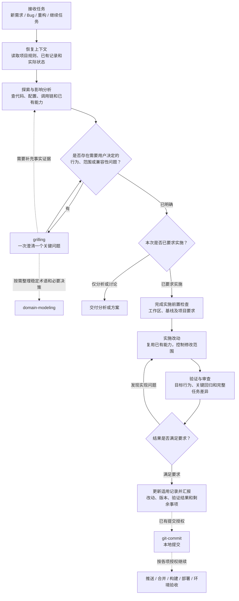
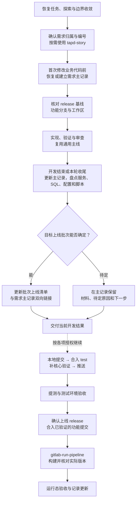

# Agent Toolkit

这个仓库用于维护个人 AI Agent 工具箱，在多台电脑和多个 Agent 环境之间复用同一套工作流。

当前包含：

- Codex 与 Claude Code 共用的 Skills
- Codex 通用 custom Agents
- OpenCode 全局配置和 custom Agents
- Codex 全局 Rules
- 公共运行时和命令入口
- 跨平台安装脚本

共享主体只使用 Codex 和 Claude Code 共同支持的 Skill 最小格式；平台专属内容放入对应平台目录，不混入通用 Skill 主契约。

## 目录结构

```text
agent-toolkit/
├── README.md
├── skills/
│   ├── git-commit/
│   ├── upload-to-easyimage/
│   ├── capture-iminling-draft/
│   ├── archery-prod-query/
│   ├── aliyun-sls-log-query/
│   ├── jumpserver-k8s-log-query/
│   ├── online-issue-triage/
│   ├── prometheus-query/
│   ├── nacos-config-query/
│   ├── tapd-story/
│   ├── feature-delivery/
│   ├── work-feature-delivery/
│   ├── grilling/
│   ├── domain-modeling/
│   ├── tapd-weekly-report/
│   ├── verify-test-db/
│   ├── local-browser-verify/
│   └── gitlab-run-pipeline/
├── codex/
│   ├── agents/
│   │   ├── evidence_explorer.toml
│   │   ├── reviewer.toml
│   │   ├── implementer.toml
│   │   ├── verifier.toml
│   │   └── design_challenger.toml
│   ├── config/
│   │   └── playwright-mcp.toml.template
│   └── rules/
│       ├── work-readonly.rules
│       ├── git-commit.rules
│       ├── github-readonly.rules
│       └── gitlab-pipeline.rules
├── opencode/
│   ├── agents/
│   │   ├── evidence_explorer.md
│   │   ├── reviewer.md
│   │   ├── implementer.md
│   │   ├── verifier.md
│   │   └── design_challenger.md
│   └── opencode.json
├── claude/
├── common/
├── evals/
│   └── workflow/
└── scripts/
    ├── install.py
    └── update_ui_ux_pro_max.py
```

目录职责：

- `skills/`：Codex、Claude Code 共用的 Skills，每个目录必须包含 `SKILL.md`。
- `codex/`：Codex 专属配置，保存可版本控制的 custom Agents、MCP 配置模板和全局 Rules。
- `opencode/`：OpenCode 专属配置。`opencode.json` 用 `{env:NAME}` 引用网关地址和密钥；`agents/` 保存 custom Agents。
- `claude/`：Claude Code 专属配置占位；没有真实配置前保持为空。
- `common/`：work 公共运行时、入口脚本和命令模板，不作为 Skill 安装。
- `evals/`：工具箱自身的行为评估材料和离线样例，不作为 Skill 安装。
- `scripts/`：工具箱自身的安装和维护脚本。

## Skill 兼容规则

共享 Skill 的 `SKILL.md` frontmatter 默认只使用：

```yaml
---
name: skill-name
description: 说明能力和触发场景
---
```

允许使用 Codex 的 `agents/openai.yaml` 作为可选展示边车，但必须满足：

- `SKILL.md` 是两端共同使用的唯一主契约。
- 主流程不能依赖 `agents/openai.yaml`。
- Claude Code 忽略边车后，Skill 仍能完整工作。
- 不在 Skill 中依赖某一端专属的私有编辑命令。

## 根目录术语

统一使用：

- `AGENT_TOOLKIT_ROOT`：本仓库根目录，例如 `~/.agent-toolkit`。
- `PYTHON_BIN`：公共运行时使用的 Python 解释器，默认指向 `AGENT_TOOLKIT_ROOT/.venv` 中的解释器。
- `WORK_ROOT`：业务工作区根目录。
- `TMP_DIR`：临时文件目录。

旧的 `SKILLS_ROOT` 只作为 work 运行时兼容别名保留，新文档和新脚本不要继续使用。

推荐 Shell 配置：

```bash
export AGENT_TOOLKIT_ROOT="$HOME/.agent-toolkit"
export PATH="$AGENT_TOOLKIT_ROOT/bin:$PATH"
```

## 安装

### 安装分类：通用与工作

安装分类由 [`install-profiles.json`](install-profiles.json) 统一维护，Skill 和 Rule 必须明确登记为 `general` 或 `work`。

| 安装选择 | 自然语言约定 | 实际范围 |
|---|---|---|
| `--profile general` | “安装通用的”“家庭电脑安装” | 通用与个人用途组件 |
| `--profile work` | “安装工作用的”“工作新机安装” | **通用组件 + 工作扩展**，不必再指定 general |

通用组的 Skills：

| Skill | 用途 |
|---|---|
| `feature-delivery` | 所有开发改动的通用流程，按复杂度和风险裁剪 |
| `git-commit` | 通用 Git 提交工作流 |
| `grilling` | 未定想法访谈，以及编码前的业务口径澄清 |
| `domain-modeling` | 通用术语与架构决策记录 |
| `local-browser-verify` | 通用网页验收 |
| `ui-ux-pro-max` | 通用 UI/UX 设计，外部 Skill |
| `capture-iminling-draft` | 个人 iminling 博客草稿 |
| `upload-to-easyimage` | 个人图床上传 |

工作扩展的 Skills：`work-feature-delivery`、`work-url-permission-sql`、`aliyun-sls-log-query`、`archery-prod-query`、`jumpserver-k8s-log-query`、`nacos-config-query`、`online-issue-triage`、`prometheus-query`、`verify-test-db`、`tapd-story`、`tapd-weekly-report`、`gitlab-run-pipeline`。

`feature-delivery` 独立提供通用开发阶段；work 业务任务由 `work-feature-delivery` 作为入口自动复用，并在执行各阶段前叠加公司要求。业务功能、Fix 及独立性能优化、重构等技术交付在编码或委派实现前必须有需求主记录，小改动只精简内容；开发收尾时核对上线材料，批次可确定则更新共享上线清单，待定则在主记录保留材料与原因。五类入口与阶段接续见 [阶段衔接](skills/work-feature-delivery/references/stages.md)；无 ID 的新业务和独立技术任务经探索、澄清及明确创建授权后取得 TAPD ID，再建立主记录。纯问答、只读排查且无已有记录时不自动建档。通用流程不依赖工作工具或凭证，项目自身规则提供实际构建、分支及记录约定。完整 `work` profile 包含两者；使用 `--skill` 手动筛选公司交付技能时，需同时选择 `feature-delivery`。

通用组同时安装全部通用 Agents、`git-commit.rules`、`github-readonly.rules` 和 Codex Playwright MCP 配置。工作组额外安装 `work-readonly.rules`、`gitlab-pipeline.rules`，并按所选 Skills 创建 GitLab 与测试库配置模板。平台和组件范围仍由 `--codex-only`、`--claude-only`、`--rules-only` 等参数限制；Claude-only 不写 Codex 配置。

首次安装必须显式选择 profile；未选择时只给出提示并退出，不默认安装全量。成功安装后，选择保存在本检出的 `.local/install-profile.json`（Git 忽略），后续无 `--profile` 的安装或更新沿用它。显式指定可覆盖选择；dry-run 和失败安装不会修改记录。记录供本检出的所有安装目标共用，不跟随 `--codex-home` 单独变化。切换 profile 不自动卸载已有组件。

完整通用安装：

```bash
# 新检出先还原外部 UI/UX Skill；安装器不隐式联网下载
python3 scripts/update_ui_ux_pro_max.py --from-lock
python3 scripts/install.py --profile general --dry-run
python3 scripts/install.py --profile general
```

完整工作新机安装：

```bash
python3 scripts/update_ui_ux_pro_max.py --from-lock
python3 scripts/install.py --profile work --dry-run
python3 scripts/install.py --profile work
python3 common/bootstrap_work.py
```

Windows 使用下文的 `py -3.11` 解释器写法和对应路径。工作运行时初始化仍是独立步骤，需要本机工作区等信息；服务凭证按需填写。通用安装不运行 bootstrap、不创建 work 运行时，也不需要安装工作用 Python 依赖。外部 `ui-ux-pro-max` 未还原时，安装器会明确提示缺失并安装其余可用内容。

`--skill` 只在当前 profile 内进一步筛选；例如 `--profile general --skill verify-test-db` 会报错，不会越过分类安装工作内容。Rules 也按 profile 过滤，因此不再因选择一个通用 Skill 而附带工作 Rules。

### Windows 前置条件

仓库的真实 Windows CI 使用 `windows-latest` 和 Python 3.11。Windows 本机安装前先准备：

- Git for Windows，并确保 `git.exe` 已加入 `PATH`。
- CPython 3.11，并安装 `py.exe` launcher、`pip` 和 `venv`。
- Windows PowerShell 5.1 的 `powershell.exe`。安装器使用它创建 directory junction，运行时使用它收紧敏感文件 ACL；PowerShell 7 的 `pwsh` 可以作为交互终端，但当前不能替代 `powershell.exe`。
- 将工具箱、用户 Home 以及 Codex/Claude 安装目标放在本机 NTFS 卷。网络盘、FAT/exFAT 和跨卷 junction 不属于已验证范围。

在 PowerShell 中先检查基础依赖：

```powershell
git --version
py -3.11 --version
py -3.11 -m pip --version
py -3.11 -c "import venv"
powershell.exe -NoProfile -Command '$PSVersionTable.PSVersion'
```

`scripts/install.py` 只负责 Skill、Agent 和 Rule 的链接或复制，以及 Codex MCP 配置的安全合并；它不创建公共虚拟环境，也不安装 Python 包。需要使用工作组的 work 公共入口或依赖公共运行时的 Skill 时，再运行 `common/bootstrap_work.py`；它会创建 `.venv` 并从 `requirements.txt` 安装 Python 依赖。

以下外部程序只在对应能力中需要，不是基础安装的硬依赖：

- Google Chrome：SLS 和 Archery 自动登录。
- `ripgrep`（`rg`）：`tapd-story` 的仓库检索，以及 `online-issue-triage` 的本地代码定位。
- `curl`（Windows 为 `curl.exe`）：`upload-to-easyimage` 的实际上传请求。
- Node.js（含 `npm` / `npx`）：运行 `local-browser-verify` 所需的 Playwright MCP、首次安装 PicGo Core 与 `web-uploader` 插件，以及维护 `ui-ux-pro-max` 外部 Skill；已有 PicGo 配置的日常上传不需要启动 Node.js 或 PicGo。
- Playwright MCP：`local-browser-verify` 的浏览器驱动；Codex 安装会写入标准 MCP 配置，首次启动时 `npx` 可能联网下载 npm 包。其他 Agent 仍由 Skill 在运行时检查，缺失时先提示并等待用户授权。
- PicGo Core 与 `web-uploader` 插件：仅在首次生成或重建 EasyImage 上传配置时需要；上传脚本日常只读取已生成的配置文件。
- Hugo：`capture-iminling-draft` 的草稿构建验证。
- `rsvg-convert`（librsvg）：`upload-to-easyimage --convert-svg`；不转换 SVG 时不需要。

### 克隆

```bash
git clone git@github.com:konghanghang/agent-toolkit.git ~/.agent-toolkit
```

Windows PowerShell：

```powershell
git clone git@github.com:konghanghang/agent-toolkit.git "$HOME\.agent-toolkit"
```

### 预览安装计划

```bash
python3 ~/.agent-toolkit/scripts/install.py --profile general --dry-run
```

### 按分类安装 Codex、Claude Code、Codex Agents、Rules 和 MCP 配置

```bash
python3 ~/.agent-toolkit/scripts/install.py --profile general
```

以下以通用安装为例；工作电脑改为 `--profile work`。安装脚本会：

1. 扫描 `skills/*/SKILL.md`，校验分类清单并按 profile 筛选。
2. 将 Skill 通过目录链接安装到 `~/.agents/skills/`。
3. 校验 `codex/agents/*.toml` 的必要字段，并将整个目录链接到 `~/.codex/agents/`。
4. 将当前 profile 的 `codex/rules/*.rules` 原子复制到 `~/.codex/rules/`。
5. 把标准 Playwright MCP 审批、禁用工具和缓存目录安全合并到 `~/.codex/config.toml`，保留其他本机配置。
6. 校验 `opencode/agents/*.md` 的 frontmatter，并把 `opencode/agents/` 链接到 `~/.config/opencode/agents/`。OpenCode 配置安装到 `~/.config/opencode/opencode.json`：macOS/Linux 使用文件链接，Windows 使用受管副本，无需文件符号链接权限。
7. 将 Skill 通过目录链接安装到 `~/.claude/skills/`。
8. 安装内容包含 `verify-test-db` 时，在缺失的情况下创建私有的 `~/.local/agent-toolkit/work/test-db/profiles.json` 模板；已有文件绝不覆盖。
9. Skill、Agent、Rule 和 Playwright 配置已经一致时跳过。
10. 旧版受管链接可以显式迁移；未知文件、真实目录链接或 Playwright 配置冲突时拒绝覆盖。OpenCode 的已有文件或目录只有在内容与仓库逐字节一致时才会接管，原路径先移到 Git 忽略的 `.local/backups/opencode/`。Windows 受管配置副本按安装记录更新；本机修改过的内容拒绝覆盖。

目录链接按平台实现：

- macOS/Linux 使用目录软链接。
- Windows 使用 NTFS directory junction，不要求开启 Developer Mode，也不复制 Skill 或 Agent 内容。
- Windows junction 创建失败时安装器会停止并保留错误信息；仓库和安装目标应位于本机 NTFS 卷，且需要可用的 Windows PowerShell。安装器不会静默回退成普通目录副本。

Windows PowerShell 示例：

```powershell
py -3.11 "$HOME\.agent-toolkit\scripts\install.py" --profile general --dry-run
py -3.11 "$HOME\.agent-toolkit\scripts\install.py" --profile general
```

### Windows 命令入口与 ExecutionPolicy

运行 bootstrap 后会同时生成 `.cmd` 和 `.ps1` 入口。PowerShell 中默认使用 `.cmd`；它不受 PowerShell ExecutionPolicy 限制，也不需要修改本机策略：

```powershell
& "$HOME\.agent-toolkit\bin\sls.cmd" --help
& "$HOME\.agent-toolkit\bin\archery.cmd" list-instances-safe
```

只有明确选择运行 `.ps1` 时才检查策略：

```powershell
Get-ExecutionPolicy -List
```

如果 `MachinePolicy` 或 `UserPolicy` 已由组织配置，保留组织策略并继续使用 `.cmd`，不要尝试覆盖。如果没有组织策略、且用户明确希望启用本机 `.ps1` wrapper，可以只在当前用户范围使用 `RemoteSigned`：

```powershell
Set-ExecutionPolicy -Scope CurrentUser -ExecutionPolicy RemoteSigned
```

安装器不会修改 `ExecutionPolicy`。不要设置 `LocalMachine` 范围，不要使用 `Unrestricted`，也不要通过持久化 `Bypass` 绕过策略；无法修改当前用户策略时继续使用 `.cmd`。

从旧的 `~/.shared-skills` 迁移时使用：

```bash
python3 ~/.agent-toolkit/scripts/install.py --replace-managed
```

可选参数：

```text
--profile NAME     general = 通用；work = 通用 + 工作扩展；省略时沿用本机记录
--dry-run          只显示计划，不修改文件
--codex-only       只安装 Codex Skills、Agents、Rules 和受管配置
--claude-only      只安装 Claude Code Skills
--rules-only       只安装 Codex Rules
--agents-only      只安装 Codex Agents
--opencode-only    只安装 OpenCode 配置和 Agents
--config-only      只安装受管的 Codex Playwright MCP 配置
--codex-home PATH  将 Agents、Rules 和受管配置安装到指定的现有 Codex Home
--skill NAME       只处理指定 Skill，可重复使用
--replace-managed  替换指向旧工具箱或旧目录结构的受管链接
```

### work 全局协作规则

规则原文件保存在 [`codex/instructions/work.md`](codex/instructions/work.md)，由本仓库统一维护版本。
源文件使用普通 Markdown 文件名，避免被 Agent 当作工具箱仓库的 `AGENTS.md` 自动加载。
这份规则适用于 `~/data/work` 的 work 环境，引用的工作区文档和 Skills 需要在使用环境中另行准备。

当前本机通过软链接保留原加载入口：

```text
~/data/work/.codex/AGENTS.md
  -> ~/.agent-toolkit/codex/instructions/work.md
```

Codex 使用 `~/data/work/.codex` 作为 Codex Home 时，从上述入口加载规则。
`~/data/work/CLAUDE.md` 保持 `@.codex/AGENTS.md` 引用，通过同一入口读取规则；
Claude Code 可能要求批准工作区外的文件导入，迁移后应在新会话中用 `/context` 核对加载结果。
日常修改请直接编辑仓库中的源文件，再检查 Git 差异并提交。

当前安装器不创建这个文件链接，`--agents-only` 只安装子 Agent 定义。
在 macOS/Linux 的新环境中，确认目标入口不存在后可手动建立链接：

```bash
mkdir -p ~/data/work/.codex
ln -s ~/.agent-toolkit/codex/instructions/work.md ~/data/work/.codex/AGENTS.md
```

如果入口已存在，应先核对并备份原内容，不使用强制覆盖选项。

### 自定义 Codex Home

安装脚本无参数运行时始终使用默认的 `~/.codex`，不会扫描磁盘、解析 Shell alias
或读取 `CODEX_HOME` 来猜测其他 Codex Home。

存在额外 Codex Home 时，由用户或对应环境的初始化脚本明确指定目录，并分别安装 Agents、Rules 和受管配置：

```bash
python3 ~/.agent-toolkit/scripts/install.py \
  --agents-only \
  --codex-home ~/data/work/.codex \
  --dry-run

python3 ~/.agent-toolkit/scripts/install.py \
  --rules-only \
  --codex-home ~/data/work/.codex \
  --dry-run

python3 ~/.agent-toolkit/scripts/install.py \
  --config-only \
  --codex-home ~/data/work/.codex \
  --dry-run

python3 ~/.agent-toolkit/scripts/install.py \
  --agents-only \
  --codex-home ~/data/work/.codex

python3 ~/.agent-toolkit/scripts/install.py \
  --rules-only \
  --codex-home ~/data/work/.codex

python3 ~/.agent-toolkit/scripts/install.py \
  --config-only \
  --codex-home ~/data/work/.codex
```

自定义 Codex Home 必须已经存在；安装脚本不会因为路径拼写错误而创建一个新的 Home。
每次运行都会输出实际使用的 Codex Home，以及本次涉及的 Agents 或 Rules 目标目录。

## 安装结果

Codex Skills：

```text
~/.agents/skills/<name>
  → ~/.agent-toolkit/skills/<name>
```

Claude Code Skills：

```text
~/.claude/skills/<name>
  → ~/.agent-toolkit/skills/<name>
```

Codex Agents：

```text
~/.codex/agents
  → ~/.agent-toolkit/codex/agents

<custom-codex-home>/agents
  → ~/.agent-toolkit/codex/agents
```

Codex Rules：

```text
~/.agent-toolkit/codex/rules/<name>.rules
  --原子复制--> ~/.codex/rules/<name>.rules

~/.agent-toolkit/codex/rules/<name>.rules
  --原子复制--> <custom-codex-home>/rules/<name>.rules
```

Codex Playwright MCP 配置：

```text
~/.agent-toolkit/codex/config/playwright-mcp.toml.template
  --安全合并--> ~/.codex/config.toml
  --安全合并--> <custom-codex-home>/config.toml
```

安装器只管理 `[mcp_servers.playwright]` 下的 `default_tools_approval_mode`、`disabled_tools`，以及 `[mcp_servers.playwright.env]` 下的 `npm_config_cache`。Playwright 尚未配置时会写入完整标准配置；已经配置时保留原有 transport、其他 MCP、模型和权限设置。受管字段存在不同值时停止并报告冲突，不静默覆盖本机选择。新建 `config.toml` 在 macOS/Linux 使用 `0600` 权限，在 Windows 将 ACL 收紧到当前用户、SYSTEM 和 Administrators；更新已有文件时保留原有 POSIX 权限或 Windows ACL。

Codex Agents 使用目录链接，多个 Codex Home 可以共享同一份受版本控制的 Agent 定义。macOS/Linux 使用软链接，Windows 使用 directory junction。目标 `agents/` 已经是真实目录或未知目录链接时，安装器拒绝覆盖；需要纳入统一管理的 Agent 应先放入本仓库的 `codex/agents/`。

OpenCode：

```text
~/.config/opencode/opencode.json
  → ~/.agent-toolkit/opencode/opencode.json

~/.config/opencode/agents
  → ~/.agent-toolkit/opencode/agents
```

上图的配置文件链接适用于 macOS/Linux；Windows 使用普通文件副本，Agents 使用目录 junction。Windows 在同目录的 `.opencode.json.agent-toolkit.json` 中记录安装内容的 SHA-256；重复安装时跳过一致的副本，仓库配置更新后重新运行安装器即可更新副本。本机文件被修改、未知文件内容不同或安装记录无效时拒绝覆盖，`--replace-managed` 也不会覆盖本机修改。已有正确的配置文件链接可继续使用。

网关地址和 API Key 只通过 `{env:NAME}` 引用，不写入仓库。`cli.json`、`tui.json`、`service.json` 和本机依赖仍留在 `~/.config/opencode/`，不由安装器管理。目标已经指向仓库时跳过；接管内容一致的普通文件或目录、更新 Windows 配置副本时，原路径先移到 `.local/backups/opencode/`；目录里有额外文件时拒绝覆盖。目录比较包含隐藏文件，文件路径和内容均须一致。

Codex 的 Rules 扫描器只加载 `rules/` 下的真实 `.rules` 文件，文件软链不会进入加载列表，因此 Rules 使用受管复制而不是目录链接。安装器通过文件头标记识别受管 Rule，安全更新已有副本，并保留本机 `default.rules`。Skill 和 Agent 目录链接不受影响。

Codex 会为新会话加载 Agents、Rules 和 MCP 配置。Agent 源文件通过目录链接立即更新，Rule 或 Playwright 配置变更后需要重新安装；完成后应新开会话或重启客户端。

## work 公共运行时

初始化：

```bash
python3 ~/.agent-toolkit/common/bootstrap_work.py
```

Windows PowerShell：

```powershell
py -3.11 "$HOME\.agent-toolkit\common\bootstrap_work.py"
```

首次初始化默认在仓库根目录创建 `.venv`，并从 `requirements.txt` 安装公共运行时和 Skill 校验依赖。`.venv` 是本机环境，不进入 Git；业务凭证和 Session 仍保存在 `~/.local/agent-toolkit/work/`。已有运行时配置会保留当前 `PYTHON_BIN` 默认值，迁移到项目环境时在交互提示中明确输入 `~/.agent-toolkit/.venv/bin/python`（Windows 使用 `.venv\Scripts\python.exe`）。

后续仓库测试和维护命令统一使用项目解释器，例如：

```bash
~/.agent-toolkit/.venv/bin/python -m unittest discover -s tests -p 'test_*.py'
```

Windows PowerShell：

```powershell
& "$HOME\.agent-toolkit\.venv\Scripts\python.exe" -m unittest discover -s tests -p "test_*.py"
```

初始化会配置：

- `WORK_ROOT`
- `TMP_DIR`
- `PROMETHEUS_BASE_URL`（可选；仅使用 `prometheus-query` 时需要）
- `NACOS_CN_BASE_URL`、`NACOS_OS_BASE_URL`（可选；仅使用 `nacos-config-query` 时需要）
- `SLS_DIR`
- `ARCHERY_DIR`
- `JMS_DIR`
- `TEST_DB_DIR`
- `GITLAB_DIR`
- `PYTHON_BIN`
- `AGENT_TOOLKIT_ROOT`

并在 `AGENT_TOOLKIT_ROOT/bin/` 生成：

- `sls`
- `archery`
- `jms`
- `testdb`
- `gitlab`
- Windows 对应的 `.cmd` 与 `.ps1` 入口

`~/.local/agent-toolkit/work/runtime.json`、凭证和 Session 都是本机状态，不提交到本仓库。

GitLab 的实际域名和 Token 保存在 `GITLAB_DIR/gitlab-credentials.json`，仓库内不写死服务地址。安装器和 bootstrap 会在文件不存在时创建仅含 `base_url`、`private_token` 两个空 value 的私有模板，已有文件绝不覆盖。填写后可用 `gitlab whoami` 验证，并用 `gitlab trigger` 触发和跟踪 Pipeline、`gitlab result` 查询最终结果。

## 当前 Skills

- `git-commit`
- `upload-to-easyimage`
  - [PicGo web-uploader 配置说明](skills/upload-to-easyimage/references/picgo-config.md)
  - [线上图文教程](https://www.iminling.com/2025/typora-how-to-use-picgo-upload-image-to-easyimage/)
- `capture-iminling-draft`
- `archery-prod-query`
- `aliyun-sls-log-query`
- `jumpserver-k8s-log-query`
- `online-issue-triage`
- `prometheus-query`
- `nacos-config-query`
- `tapd-story`
- [feature-delivery](skills/feature-delivery/SKILL.md)：通用开发流程，覆盖功能、修复、重构、脚本、Skill、配置及文档改动
- [work-feature-delivery](skills/work-feature-delivery/SKILL.md)：复用通用流程，叠加 work 分支、提测及发布要求
  - [work 交付规则](skills/work-feature-delivery/references/delivery-workflow.md)：分支、提测和上线流程的统一维护位置
- `grilling`
- `domain-modeling`
- `tapd-weekly-report`
- `verify-test-db`
  - [测试库配置](skills/verify-test-db/references/configuration.md)
- `local-browser-verify`
  - [线索信息管理待初审夹具](skills/local-browser-verify/references/clue-unsubmitted-fixture.md)
- `gitlab-run-pipeline`

## Skills 开发工作流

本节说明如何使用这些 Skills 完成开发任务。流程由主 Agent 根据任务目标、项目规则和已有授权衔接，从当前阶段继续；已有方案、代码和有效验证结果直接复用。

- 通用项目、脚本、Skill、配置和文档维护，使用 [feature-delivery](skills/feature-delivery/SKILL.md)。
- work 业务开发，使用 [work-feature-delivery](skills/work-feature-delivery/SKILL.md)。它自动复用通用主线，并在各阶段执行前叠加公司要求。
- 纯问答、只读分析、单独审查或提交，完成本次要求的范围即可；专项任务直接使用对应 Skill。

### 通用开发主线



能查证的事实先查证；需要运行结果才能判断的问题，在授权范围内做必要验证或最小实验；影响产品行为、兼容性、范围或验收的真实取舍，再交给 `grilling`。澄清没有固定轮数，无未决项时直接继续。

已要求实施且前置条件满足时，连续完成实现、本地验证、审查和结果汇报。提交、推送、合并、部署及数据库写入分别依据明确授权，已有有效授权不重复询问。必要验证失败先修复；缺少条件或无法继续时，报告具体阻塞和未验证边界，继续独立可做的部分。

### work 业务开发扩展

下图展开公司要求及后续交付阶段，与通用主线共同执行。五类任务入口、阶段前置条件和证据要求见 [阶段衔接](skills/work-feature-delivery/references/stages.md)，具体规则以 [work 交付规则](skills/work-feature-delivery/references/delivery-workflow.md) 及目标仓库约定为准。



- 独立业务功能、性能优化和重构等非 Bug 业务代码交付使用真实 TAPD ID；既有需求内的必要技术调整归原需求。仅已确认没有 TAPD 编号的 Bug Fix，可按规则使用稳定的 `fix-` 编号。
- 需新增 TAPD 时，先收敛范围，再依据明确创建授权通过 `tapd-story` 取得真实 ID；认可方案、创建需求和实施分别按已有授权判断。
- 业务代码实施前必须有需求主记录，小改动只精简内容；开发收尾时也要检查上线材料，无须等到提交、提测或合入 `test`。
- 开发分支基线与上线批次分别判断；批次待定时保存材料和原因，不阻塞其他前置条件已满足的授权开发。上线合入以已验证的功能分支或对应提交为依据。
- 实现完成、本地验证、测试环境验证、部署和运行态验收分别记录；Pipeline 成功不能代替业务验收。

### 专项 Skill 与 Agent 分工

专项 Skill 按任务需要参与：

| 任务环节 | 参与的 Skill | 主要作用 |
|---|---|---|
| 读取或管理需求 | [tapd-story](skills/tapd-story/SKILL.md) | 获取需求正文、图片、附件；按授权创建或更新需求 |
| 明确业务口径 | [grilling](skills/grilling/SKILL.md)、[domain-modeling](skills/domain-modeling/SKILL.md) | 收敛关键取舍，整理稳定术语及必要决策 |
| 界面设计与实现 | `ui-ux-pro-max` | 辅助交互、布局、视觉和可访问性设计；外部 Skill 的还原见安装说明 |
| 排查现象与根因 | [online-issue-triage](skills/online-issue-triage/SKILL.md)，以及日志、监控、配置查询 Skill | 结合代码与环境证据定位问题 |
| 验证实际行为 | [local-browser-verify](skills/local-browser-verify/SKILL.md)、[verify-test-db](skills/verify-test-db/SKILL.md) | 按需验证网页路径、数据库状态与异步结果 |
| 提交与构建 | [git-commit](skills/git-commit/SKILL.md)、[gitlab-run-pipeline](skills/gitlab-run-pipeline/SKILL.md) | 完成已授权的 Git 操作和流水线操作 |

主 Agent 负责目标、授权、方案整合和最终交付。需要分工时，`evidence_explorer` 负责探索，`design_challenger` 检验难以逆转的设计取舍，`implementer` 实施，`verifier` 验证，`reviewer` 审查。简单任务由当前 Agent 完成；具体触发条件、交接范围及输出要求见 [Agent 分工](skills/feature-delivery/references/agent-orchestration.md)。

## 工作流行为评估

修改交付流程或 Agent 契约时，可用 [工作流行为评估](evals/workflow/README.md) 在临时目录准备可复用场景，检查授权延续、完整审查、证据分层、操作范围、事实查证和重复错误约束。先运行 `python evals/workflow/prepare.py`，再按说明在新会话执行并核对实际轨迹。

准备脚本不启动模型或真实浏览器。格式校验、离线样例测试、真实模型行为观察和真实环境验收分别报告；行为评估不是所有小改动的强制门禁。

## 通用 Agent 功能一致性

`codex/agents/<name>.toml` 与 `opencode/agents/<name>.md` 按同名成对维护，两个目录的 agent 名称集合必须一致。

新增、修改或删除任意一个 agent 时，必须在同一次改动中同步另一边，不能先改一边、把另一边留到以后。两端应完成同一种任务，保持职责、任务边界、证据要求和输出契约一致，并具备完成任务所需的读取、搜索和 Git 检查能力。模型、工具、沙箱和权限使用各自平台的字段，按实际行为核对；一边独有的步数限制或工具限制不能削弱任务能力。

| 功能契约 | Codex | OpenCode |
|---|---|---|
| 目录枚举、内容搜索和定点读取 | 使用父会话允许的工具 | 内置目录、grep 和 read 工具，角色不额外禁用必要读取 |
| Git 差异、状态和历史检查 | 使用父会话允许的命令，不执行 Git 交付 | 只读角色保留 Git 检查；执行角色沿用全局默认规则并拒绝常见 Git 写命令 |
| 探索、审查、设计质疑 | 正文约束只读，实际权限继承父会话 | 拒绝 `edit`，默认拒绝 shell，仅放行 Git 检查 |
| 实现 | 按交接范围修改及验证，实际权限继承父会话 | 编辑和普通运行沿用全局默认规则，不额外增加通配 `allow` |
| 运行验证 | 可生成授权产物，不修改受审源码和正式测试 | 拒绝直接 `edit`，运行沿用全局默认规则，正文保护受审实现 |
| 分工与输出 | 不自行派生；返回范围、版本、证据和缺口 | 同一职责并拒绝 `subagent`，不另设 20 步截断 |

Codex 现行官方契约规定自定义角色继承父会话的沙箱、审批、provider 和 MCP，角色文件中的 `sandbox_mode` 不覆盖父配置。本机 0.163.0 尚未逐字段实测，故只读角色保留旧 `sandbox_mode = "read-only"` 标记用于兼容，但不将其视为已生效的独立沙箱证据。需要系统级只读保证时，应在父会话选择相应权限，不能把角色正文当成独立隔离。OpenCode V2 子角色使用自身权限，不是父角色权限的子集；全局规则后追加角色规则，按最后匹配生效，agent 规则可覆盖 global 规则；新执行角色不添加 `edit` 或 `shell` 的通配允许。即便 `edit` 被拒绝，允许的 shell 仍可能间接写文件，常见 Git 命令拒绝也不是任意程序的行为证明。功能验收应按角色核对读取、搜索、运行、直接工具限制和范围遵守情况，并分别说明配置、原生加载、模型行为与系统隔离的覆盖。依据：[Codex Subagents](https://learn.chatgpt.com/docs/agent-configuration/subagents)、[OpenCode V2 Agents](https://opencode.ai/v2/docs/agents)、[OpenCode V2 Permissions](https://opencode.ai/v2/docs/permissions)。

新角色省略模型配置，使用各平台的父会话或默认模型；现有 `evidence_explorer` 和 `reviewer` 的显式模型配置保留。角色定义不会自行启动工作；[通用流程的 Agent 分工规则](skills/feature-delivery/references/agent-orchestration.md) 规定触发条件，满足条件时主 Agent 应主动委派。小任务不启动全套角色。

提交前核对名称集合、成对任务指令及只读能力，运行 `tests/test_agent_pairs.py` 对应的仓库测试，并同时更新下方两个列表。测试覆盖配置契约；真实模型任务验收需另外执行。

## 当前 Codex Agents

- `evidence_explorer`：只读追踪真实调用链、数据边界、行为分支和待确认项，向主 Agent 返回带代码证据的压缩结果，不修改代码或生成最终计划。
- `reviewer`：只读审查当前改动，按严重程度返回正确性、回归、安全和测试缺口，不修改文件。
- `implementer`：按已确认契约完成分配范围的实现及局部验证，不操作 Git 交付或扩大需求。
- `verifier`：执行已授权复现、验收或性能检查，返回版本化行为证据，不修改受审源码和正式测试。
- `design_challenger`：只读检验难以逆转的设计，比较有据可查的候选和兼容代价，不替用户作取舍。

## 当前 OpenCode Agents

- `evidence_explorer`：只读追踪真实调用链、数据边界、行为分支和待确认项，向主 Agent 返回带代码证据的压缩结果，不修改代码或生成最终计划。
- `reviewer`：只读审查当前改动，按严重程度返回正确性、回归、安全和测试缺口，不修改文件。
- `implementer`：按已确认契约完成分配范围的实现及局部验证，不操作 Git 交付或扩大需求。
- `verifier`：执行已授权复现、验收或性能检查，返回版本化行为证据，不修改受审源码和正式测试。
- `design_challenger`：只读检验难以逆转的设计，比较有据可查的候选和兼容代价，不替用户作取舍。

OpenCode 的网关和密钥来自运行 OpenCode 服务的进程环境：`NEWAPI_BASE_URL`、`GROK_API_KEY`、`NEWAPI_GEMINI_API_KEY`、`NEWAPI_CODEX_API_KEY`、`NEWAPI_ZAI_API_KEY`。变量缺失时 `{env:NAME}` 会原样保留，请求不会改用另一台机器的地址。修改这些变量后需要重启 OpenCode 服务。

## 当前 Codex Rules

- `work-readonly.rules`：允许 work 的登录、受限 SLS 查询、Archery 元数据查询、固定测试命名空间日志查询，以及测试库元数据、受限查询、脱敏验证和只生成计划的写入准备；生产 SQL、测试库实际写入、任意 SLS 查询和通用 JMS 命令仍需审批。
- `git-commit.rules`：自动允许从 `origin` 获取更新、通过 `git switch -c` 新建分支，以及受控的 `git add`、新提交和普通主分支推送。
- `github-readonly.rules`：自动允许 `gh pr view/checks`、`gh run list/view`、`gh issue view` 和 `gh repo view`。
- `gitlab-pipeline.rules`：自动允许 `gitlab whoami/search/resolve/inspect/result/trigger` 六个子命令；Rule 只取消 Codex 权限弹窗，`trigger` 仍由 CLI 强制校验 `plan_id`、用户确认、计划漂移和生产环境授权。

Rules 的 `allow` 只处理命令越过沙箱的权限，不替代 Skill、`AGENTS.md` 或用户指令中的操作边界。

## 新增 Codex Agent

新的 Codex custom Agent 必须：

1. 放入 `codex/agents/<agent-name>.toml`。
2. 至少定义 `name`、`description` 和 `developer_instructions`。
3. 使用清晰、稳定、项目无关的职责边界；项目特定规则继续放在项目 `AGENTS.md`。
4. 实际权限遵守父会话；只读角色可保留 `sandbox_mode = "read-only"` 兼容标记，但不得把它当作生效证明或用角色配置请求更宽权限。正文按职责明确只读、文件归属或验证产物范围。
5. 不写入凭证、个人机器绝对路径或某个项目独有的业务口径。
6. 同一次改动中按「通用 Agent 功能一致性」同步 `opencode/agents/<agent-name>.md`。
7. 完成后运行安装器单元测试，以及默认和自定义 Codex Home 的 `--agents-only --dry-run`。

## 新增 OpenCode Agent

新的 OpenCode custom Agent 必须：

1. 放入 `opencode/agents/<agent-name>.md`。
2. 使用 YAML frontmatter，至少定义 `description` 和 `mode`，正文作为 agent 指令。
3. 按职责配置工具：只读角色拒绝 `edit` 并只放行 Git 检查；执行角色沿用全局默认与自身规则，不用通配 `allow` 放大编辑或运行权限；验证角色另拒绝直接编辑。所有角色禁止自行派生及执行 Git 交付。
4. 模型、网关和密钥使用可移植引用；不要写入真实 URL、API Key 或个人机器绝对路径。
5. 同一次改动中按「通用 Agent 功能一致性」同步 `codex/agents/<agent-name>.toml`。
6. 完成后运行安装器单元测试，以及 `--opencode-only --dry-run`。

## 新增 Skill

新的共享 Skill 必须：

- 在 `install-profiles.json` 的 `skills` 中登记 `general` 或 `work`，并同步上方分类说明。通用/个人项目能力归 general，内部服务、工作凭证、工作流程专用能力归 work；通用 Skill 对工作场景的可选说明不构成工作运行时依赖。
- 未登记分类或分类值无效时，安装器拒绝继续。外部 Skill 也必须登记；暂未还原的已登记外部 Skill 可以缺席。
- 新 Rule 同样登记到清单的 `rules`。当前 Agent 目录、OpenCode 配置和 Playwright 配置为通用共享组件；工作专属 Agent/MCP 不能直接加入共享目录或模板，须先扩展安装器隔离机制。


1. 放入 `skills/<skill-name>/`。
2. 同时兼容 Codex 和 Claude Code。
3. 使用公共 `SKILL.md` frontmatter。
4. 不写入凭证、Token、Cookie、Session 或个人机器绝对路径。
5. 将确定性逻辑放入自身 `scripts/`。
6. 将详细参考资料放入自身 `references/`。
7. 不在 Skill 目录额外创建 README、安装指南或变更日志。
8. 完成后运行 Skill 校验和安装脚本 dry-run。

## 机器相关配置

这些值不要提交：

- API Key、Token、Cookie、Session
- SSH 私钥和认证文件
- EasyImage、PicGo 的真实凭证
- 数据库和生产环境凭证
- Prometheus、Nacos 等通过 `runtime.json` 管理的内部服务地址
- `~/.local/agent-toolkit/work/runtime.json`
- 工作区绝对路径

例如 `capture-iminling-draft` 的目标仓库路径应在每台机器单独设置：

```bash
git config --global iminling.repoPath /absolute/path/to/iminling-pages
```

## 更新

拉取工具箱：

```bash
git -C ~/.agent-toolkit pull
```

Skill、Codex Agent 和 OpenCode 的目录或文件链接会立即读取仓库内更新。Windows 的 OpenCode 配置副本和 Rules 都需要拉取后重新运行安装器才能更新。OpenCode 配置变更后需要 `opencode reload` 或重启服务。更新 Rules：

```bash
python3 ~/.agent-toolkit/scripts/install.py --rules-only
```

Windows 更新 OpenCode 配置：

```powershell
py -3.11 "$HOME\.agent-toolkit\scripts\install.py" --opencode-only --dry-run
py -3.11 "$HOME\.agent-toolkit\scripts\install.py" --opencode-only
```

Agent 或 Rule 更新后，新开会话或重启客户端使其生效。

### 更新外部 `ui-ux-pro-max`

`ui-ux-pro-max` 来自
[`nextlevelbuilder/ui-ux-pro-max-skill`](https://github.com/nextlevelbuilder/ui-ux-pro-max-skill)，
本地内容保存在 `skills/ui-ux-pro-max/` 并通过 `.gitignore` 排除，不直接提交上游生成文件。

预览官方最新版的生成和校验结果：

```bash
python3 ~/.agent-toolkit/scripts/update_ui_ux_pro_max.py --dry-run
```

确认后更新：

```bash
python3 ~/.agent-toolkit/scripts/update_ui_ux_pro_max.py
```

脚本会使用官方 npm CLI 在临时目录生成当前 `.agents/skills/` 版本，并兼容旧版
`.codex/skills/` 输出；只提取主 `ui-ux-pro-max` Skill。更新前会运行可独立执行的
上游单元测试、数据校验和搜索 smoke test，再把详细检查表迁入 `references/` 做渐进
披露，最后原子替换共享目录。只适用于上游源码仓库、依赖未打包维护脚本的测试会被
明确列为 source-only，不会伪装成已通过。旧版本保存在 Git 忽略的 `.local/backups/`，
版本、来源、本地转换和内容摘要记录在 `external-skills.lock.json`。

如需安装指定版本：

```bash
python3 ~/.agent-toolkit/scripts/update_ui_ux_pro_max.py --version 2.10.2
```

全新检出或 CI 可严格按锁文件还原版本、本地转换和内容摘要，且不重写锁文件：

```bash
python3 ~/.agent-toolkit/scripts/update_ui_ux_pro_max.py --from-lock
```

提交前按改动的影响范围检查。未受影响、且内容和相关环境未变化的项目可复用有效结果，注明对应版本与覆盖范围；未执行、跳过和真实环境验收分别报告。安装器改动仍须检查 general、work 两个 profile。

- Skill 或安装清单改动：校验相关 Skill 格式和显式分类；安装器改动校验所有可安装 Skill。
- 安装器改动：覆盖各平台的链接权限、路径表示、配置保护和重复安装行为；两个 profile 的 dry-run 无未知冲突，Codex 与 Claude Code 的 Skill 目录链接目标正确。
- Agent 改动：核对两端名称、任务与输出契约，以及各角色的读取、搜索、运行、编辑与交付限制；检查默认和自定义 Codex Home 的 Agent 目录链接，以及 OpenCode Agent 目录链接。
- OpenCode 配置或安装逻辑改动：macOS/Linux 检查配置文件链接目标；Windows 检查受管副本内容与安装记录摘要。仓库内只有网关和密钥的环境变量引用。
- Rules 改动或安装迁移：确认受管 Rules 为与源文件一致的真实文件，执行 `codex execpolicy check --rules <文件> <命令及参数>`，检查代表性的允许与未放行命令；复用结果时明确记录来源。
- 路径或迁移改动：除迁移兼容说明外，没有旧 `~/.shared-skills` 路径残留。
- 每次提交：审查完整任务差异，确认没有凭证和机器相关运行时文件进入 Git，记录验证版本与范围。
