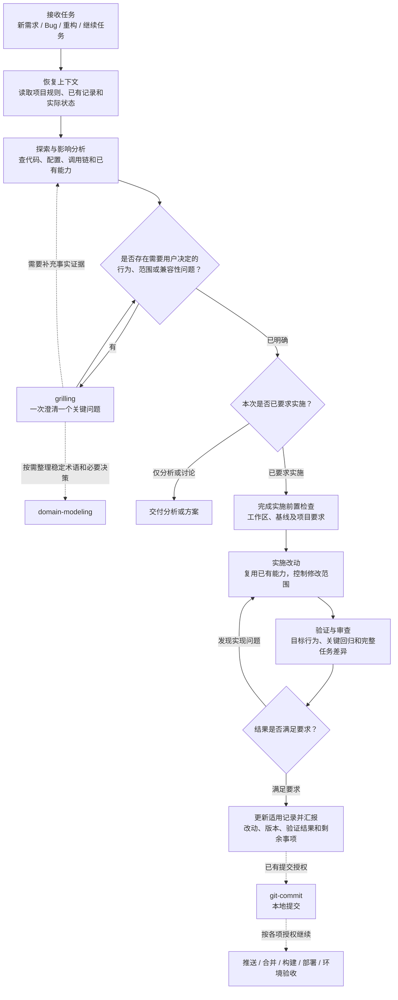
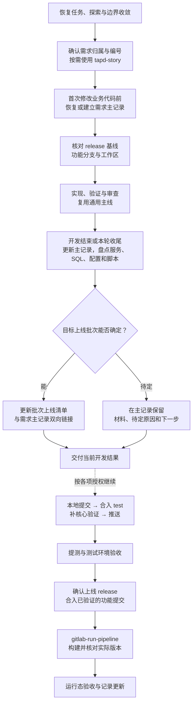

# 开发工作流

[返回首页](../README.md) · [安装指南](installation.md) · [维护指南](maintenance.md)

本文说明如何使用这些 Skills 完成开发任务。流程由主 Agent 根据任务目标、项目规则和已有授权衔接，从当前阶段继续；已有方案、代码和有效验证结果直接复用。

- 通用项目、脚本、Skill、配置和文档维护，使用 [feature-delivery](../skills/feature-delivery/SKILL.md)。
- 工作项目开发，使用 [work-feature-delivery](../skills/work-feature-delivery/SKILL.md)。它自动复用通用主线，并在各阶段执行前叠加公司要求。
- 纯问答、只读分析、单独审查或提交，完成本次要求的范围即可；专项任务直接使用对应 Skill。纯问答、只读排查且无已有记录时不自动建档。

通用流程不依赖工作工具或凭证；实际构建、分支及记录约定由目标项目规则提供。

## 通用开发主线

能查证的事实先查证；需要运行结果才能判断的问题，在授权范围内做必要验证或最小实验；影响产品行为、兼容性、范围或验收的真实取舍，再交给 `grilling`。澄清没有固定轮数，无未决项时直接继续。

已要求实施且前置条件满足时，连续完成实现、本地验证、审查和结果汇报。提交、推送、合并、部署及数据库写入分别依据明确授权，已有有效授权不重复询问。必要验证失败先修复；缺少条件或无法继续时，报告具体阻塞和未验证边界，继续独立可做的部分。

## 工作项目开发扩展

下图展开公司要求及后续交付阶段，与通用主线共同执行。五类任务入口、阶段前置条件和证据要求见 [阶段衔接](../skills/work-feature-delivery/references/stages.md)，具体规则以 [工作项目交付规则](../skills/work-feature-delivery/references/delivery-workflow.md) 及目标仓库约定为准。

- 独立业务功能、性能优化和重构等非 Bug 业务代码交付使用真实 TAPD ID；既有需求内的必要技术调整归原需求。仅已确认没有 TAPD 编号的 Bug Fix，可按规则使用稳定的 `fix-` 编号。
- 需新增 TAPD 时，先收敛范围，再依据明确创建授权通过 `tapd-story` 取得真实 ID，再建立需求主记录；认可方案、创建需求和实施分别按已有授权判断。
- 编码或委派实现前必须有需求主记录，小改动只精简内容；开发收尾时也要检查上线材料，无须等到提交、提测或合入 `test`。
- 开发分支基线与上线批次分别判断；批次待定时保存材料和原因，不阻塞其他前置条件已满足的授权开发。上线合入以已验证的功能分支或对应提交为依据。
- 实现完成、本地验证、测试环境验证、部署和运行态验收分别记录；Pipeline 成功不能代替业务验收。

## 专项 Skill 与 Agent 分工

专项 Skill 按任务需要参与：

| 任务环节 | 参与的 Skill | 主要作用 |
|---|---|---|
| 读取或管理需求 | [tapd-story](../skills/tapd-story/SKILL.md) | 获取需求正文、图片、附件；按授权创建或更新需求 |
| 明确业务口径 | [grilling](../skills/grilling/SKILL.md)、[domain-modeling](../skills/domain-modeling/SKILL.md) | 收敛关键取舍，整理稳定术语及必要决策 |
| 界面设计与实现 | `ui-ux-pro-max` | 辅助交互、布局、视觉和可访问性设计；外部 Skill 的还原见 [安装说明](installation.md#安装分类与本机记录) |
| 排查现象与根因 | [online-issue-triage](../skills/online-issue-triage/SKILL.md)，以及日志、监控、配置查询 Skill | 结合代码与环境证据定位问题 |
| 验证实际行为 | [local-browser-verify](../skills/local-browser-verify/SKILL.md)、[verify-test-db](../skills/verify-test-db/SKILL.md) | 按需验证网页路径、数据库状态与异步结果 |
| 提交与构建 | [git-commit](../skills/git-commit/SKILL.md)、[gitlab-run-pipeline](../skills/gitlab-run-pipeline/SKILL.md) | 完成已授权的 Git 操作和流水线操作 |

主 Agent 负责目标、授权、方案整合和最终交付。需要分工时，`evidence_explorer` 负责探索，`design_challenger` 检验难以逆转的设计取舍，`implementer` 实施，`verifier` 验证，`reviewer` 审查。简单任务由当前 Agent 完成；具体触发条件、交接范围及输出要求见 [Agent 分工](../skills/feature-delivery/references/agent-orchestration.md)。

浏览器验收中的 [线索信息管理待初审夹具](../skills/local-browser-verify/references/clue-unsubmitted-fixture.md)用于对应测试数据的准备与恢复。修改流程后的行为评估见 [维护指南](maintenance.md#工作流行为评估)。
